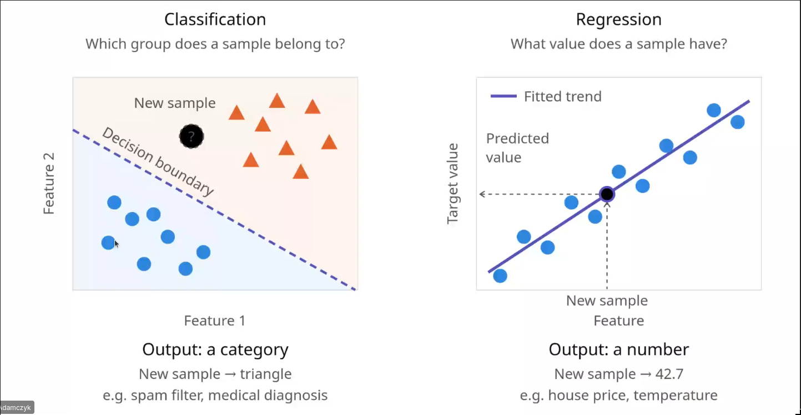
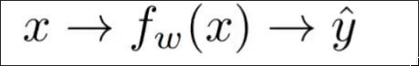

# Organizacja

---

- Adamczyk nagrywa wykłady (goat)
- Na zajęciach jesteśmy na "ty" (double goat)
- Przedmiot jest przeglądowy, nie zagłębiamy się w nic szczególnego
  - although jak się uda to na koniec powiemy coś więcej, zwłaszcza że wykładów jest więcej niż labów 
- Wykłady nie są obowiązkowe, ale wiedza z wykładów jest obowiązkowa 
- Będą wejściówki
- Za obecność są dodatkowe plusy (liczba obecności / 3)
- **Kartkówka** (nie trzeba zaliczyć każdej z osobna, trzeba zaliczyć sumarycznie), na pierwszym labie nie ma kartkówki
  - Jedno pytanie z ostatniego wykładu (będzie lista zagadnień na koniec każdego wykładu)
  - Jedno pytanie z poprzedniego labu (żeby sprawdzić czy czegoś się ostatnio nauczyliśmy)
- Plusy
  - Za aktywność na labach i wykładzie 
  - Za poprawki w labach, już teraz Adamczyk zakłada że w materiałach będą 
- Boże jak ten chłop zapierdala jak Eminem wtf
- Zestawy zadań
  - Każdy jeden zestaw trzeba zaliczyć
  - Jupyter Notebook
  - Można robić lokalnie lub w Google Colab
  - U Adamczyka oddajemy na Teamsach
  - Termin na oddanie zadań jest do następnych labów, lub do dnia kiedy te laby powinny się odbyć
  - Spóźnienie = punty za lab mnożymy razy 0.8
    - Można spóźnić się raz bez konsekwencji (goat)
- Nieobecności
  - Max 1 nieusprawiedliwiona --> 0 punktów z kartkówki
  - Dowolna ilość usprawidliwionych, usprawiedliwienie pozwala odrobić kartkówkę
- Nie używamy LLMów do pisania kodu
- Linki do wszystkich prezentacji są na zespole Teams w katalogu `shared`

---

# Machine Learning

## Uczenie maszynowe

Podzbiór AI, gdzie modele uczą się ze zbiorów danych i modelują się na tej podstawie

AI - Nie wymaga zbioru danych do nauki

ML - wymaga zbioru danych do modelowania

Na potrzeby uczenia maszynowego potrzebujemy jak najwięcej danych

Dane do modelowania powinny być:

- W dużej ilości
- Realistyczne, nie artificial
- Różnorodne

**Data curation** = czyszczenie danych wejściowych (pozwala na uzyskanie lepszego modelu)

**Modalność** = typ wejścia do modelu (forma danych wejściowych, np tabele / obrazy / tekst)

Gdy już mamy zebrane dane, możemy zacząć rozpoznawać wzorce (pattern recognition)

### Deep learning 

Podzbiór uczenia maszynowego wykorzystujący wiele poziomów sieci neuronowych

### Uczenie nadzorowane

Najczęstszy sposób uczenia

- Zebranie próbek
- Przypisanie *Labeli* do próbek

### Uczenie nienadzorowane

Cięższe w pomiarze jakości

- Też mamy próbki
- Nie mamy *labeli*

### Uczenie ze wzmocnieniem

- Mamy agenta w środowisku wykonawczym
- Agent zbiera dane o aktualnym stanie źrodowiska
- Agent zmienia stan środowiska i dostaje nagrodę w zależności od tego, czy zbliżył się do celu

### IID assumption

**IID** = Independent and Identically Distributed

Zawsze zakładamy że nasze dane są IID, chociaż zwykle tak nie jest xD

Im bliżej nasze dane są do faktycznego IID, tym lepsze dostaniemy wyniki

### Regresja i klasyfikacja

**Regresja** - uporządkowane wartości, na przykład ceny domów, rozpuszczalność substancji

**Klasyfikacja** - nieuporządkowany, skończony, dyskretny zbiór klas (na przykład pytania tak/nie)

Przykład: liczba gwiazdek na googlu - jest zbiorem dyskretnym, ale jest uporządkowane, co przeważa o tym, że gwiazdki są regresją

---

# Uczenie modelu

### Funkcja

Nauczony model staje się funkcją

Funkcja może nie mieć zamkniętego wzoru (cokolwiek to znaczy), ale w uczeniu maszynowym traktujemy wyuczony model jako funckję.

Bardzo często nie możemy (a przynajmniej jest to bardzo trudne) wypisać kroków algorytmu funkcji

### Trening

Model dostaje training dataset

Uczy się parametrów i wag w tym modelu

### Predykcja

Po zakończeniu treningu, do modelu można podawać nowe, nieznane dane, i spodziewać się poprawnego wyniku

----

# Uczenie tabelaryczne

Zbiór danych to dosłownie po prostu tabele

**Wiersze** = próbki

**Kolumny** = cechy

Tabele najczęściej interpretujemy jako wielowymiarowe macierze, a próbki jako wektory w tych macierzach

### Typy danych w tabelach

- Metadane (id, znak zodiaku, nieużyteczne dane) - do wyjebania
- Zmienne numeryczne - zajebiste, chcemy
- Zmienne logiczne - spoko
- Kategorie - ?

### EDA

Exploratory data analysis - wstępna analiza danych

Analiza całości danych w datasetcie w poszukiwaniu niezgodności

### Feature engineering

Wszystkie operacje na zbiorze danych, które w jakiś sposób go modyfikują

Standardowe kroki przygotowania danych tabelarycznych:

- <u>Uzupełnienie brakujących danych</u>

  - **Ręczne uzupełnienie wartości** na podstawie innych danych, na przykład uzupełnienie wieku danej osoby lub uzupełnienie wartości nieruchomości na podstawie lokalizacji i powierzchni
  - Często używa się **gotowych modeli** do imputacji danych wejściowych 
  - Czasami bardziej opłaca się **odrzucić wiersz** niż uzupełniać wartości 
  - Uzupełnienie wartości zakłada, że była to wartość "missing at random". Czasem brak wartości również jest ważną informacją - w takim przypadku można stworzyć nową zmienną oznaczającą brak wartości

- <u>Zakodowanie wartości kategorii</u>

  - Zazwyczaj wartości nie da się uporządkować, na przykład kolory
  - Czasem kategorie da się porządkować, na przykład jakość
  -  Cardinality = liczba kategorii
  - **One-hot encoding** = tworzenie K kolumn dla K kategorii, wpisujemy 1 w kolumnie danej kategorii, jeżeli dana próbka należy do kategorii
    - Fajne bo proste i szybkie
    - Średnie bo może aksplodować jeśli mamy dużo kategorii
  - **Ordinal encoding** = opisywanie kategorii które da się porządkować, jako kolejne numery (zły = 0; średni = 1, dobry = 2)
    - Fajne bo proste
    - Średnie bo czasem mało precyzyjne, ale porządkowanie kategorii z natury jest mało precyzyjne

- <u>Wywalenie outlayerów</u>

  - Usuwanie atypowych punktów
  - Modele często przypisują bardzo duże wagi outlayerom, tym bardziej powinniśmy się ich pozbywać
  - Outlayerów możemy potraktować na dwa sposoby:
    - **Wywalić** totalnie ze zbioru danych
    - Ręcznie **obniżyć wagę** danego outlayera

- <u>skalowanie wartości numerycznych</u>

  - Transformuje dane w celu ujednolicenia skali numerycznej

  - Pozwala na przyspieszenie i zwiększenie jakości treningu

  - Jest bardzo czułe na outlayerów, dlatego należy się ich pozbyć przed skalowaniem

  - Sposoby skalowania

    - MinMax - zamienia przedział [a, b] na [0, 1]

      Fajne bo proste

    - Standaryzacja - zbliża dane do średniej lub mediany

      Fajne bo daje dobre wyniki, wymagane przez niektóre modele

---

# Regresja liniowa

Modele które modelują dane jako wzór w postaci kombinacji liniowej

### Nauka modelu liniowego

Nauka modelu liniowego polega zazwyczaj po prostu na zadaniu optymalizacji, dla którego funkcją różnicy jest `Loss function` określająca różnicę między przewidywanymi a prawdziwymi wynikami

Różne modele liniowe będą używały różnej `Loss function`

#### Modele regresji liniowej

Modele regresji liniowej to rodzaj modeli liniowych, których `loss function` jest **MSE** - mean squared error

Cechy MSE:

- Jest dwukrotnie różniczkowalna
- Ma jedno minimum (co jest bardzo korzystne)
- Do rozwiązania można dojść analitycznie

### Zastosowania modeli liniowych

- Modele liniowe są bardzo proste i szybkie, dzięki czemu używa się ich jako **baseline**'u - jeżeli bardziej skomplikowany model nie jest znacząco lepszy od liniowego, nie ma sensu go używać, skoro można zostać przy prostszym (liniowym)

- Bardzo dobrze działają **w czasie rzeczywistym** (bo są szybkie)

---

# <u>Jakość modeli</u>

Podczas treningu mamy pełnie dane - zarówno wejście, jak i wynik. Ponadto, podczas treningu nie obchodzi nas wydajność treningu. W praktyce, nie mamy oczywiście wyników, oraz zależy nam na szybkości działania

### Generalizacja

Generalizacja = zdolność modelu do działania na nowych, nieznanych danych

Podczas treningu minimalizujemy błąd względem znanych wyników, aby dla nowych danych dostać jak najprecyzyjniejszy wynik

### Testowanie modeli

Mamy dwie główne metody:

- **Houldout** = dzielimy dane na dwa kawałki - zbiór treningowy i testowy

  - Fajne bo proste i szybkie

  - Średnie bo mało precyzyjne w przypadku małego zbioru testowego

- **Cross-validation**

  - Działanie:
    - Dzielimy dataset na K części
    - Trenujemy model na pierwszej części, testujemy na drugiej
    - Potem trenujemy na dwóch pierwszych częściach i testujemy na trzeciej
    - Itd trenujemy na N pierwszych częściach i testujemy na N+1 aż wyczerpiemy wszystkie K części
  - Fajne bo pozwala na wszyskolene bardzo precyzyjnego modelu
  - Potencjalnie bardzo ciężkie obliczeniowo

**NIGDY NIE ROBIMY INPUTACJI DANYCH NA ZBIORZE TESTOWYM**

### Mierzenie jakości modelu

Dwa sposoby:

- Root mean squared error
  - czułe na outlayerów
- Mean absolute error
  - Bardziej odporne na outlayerów
  - Dużo częściej używane do ewaluacji modeli

Obie te metryki dadzą wyniki w skali danych wejściowych, czyli jeżeli operujemy dużymi liczbami, dostaniemy duże błędy (liczbowo)

### Błędy modelu

**Bias** = dane są bardziej złożone niż zakładano

**Wariancja** = model jest zbyt potężny dla danych, uczy się zbyt szczegółowych rzeczy, szumu

Chcemy niskiego biasu i niskiej wariancji. Zazwyczaj proste modele mają wysoki bias, a potężniejsze mają wysoką wariancję

**Capacity** = zdolność modelu to rozumienia danych wejściowych

- Zbyt małe capacity **(underfitting)** prowadzi do wysokiego biasu. Wychodzi to w złych wynikach zarówno na zbiorach treningowych jak i testowych
- Zbyt duże capacity **(overfitting)** zwiększa wariancję. Overfitting daje bardzo dobre wyniki na zbiorze treningowym, ale nagle dostaje bardzo średnie wyniki na zbiorze testowym

### Regularyzacja

Upraszcza (ogłupia) model, w celu uniknięcia efektów overfittingu

Dlatego **karzemy za duże wagi** - dodajemy do `loss function` dodatkowy składnik

**λ** = siła regularyzacji. Nie jest uczona, ustawiamy ją sami przed treningiem (to **hiperparametr**)

#### Ridge regression (L2)

- Regresja liniowa + suma **kwadratów** wag w `loss function`
- Mocno zniechęca do dużych wag, ale ich nie zeruje
- Da się rozwiązać analitycznie (SVD)

#### LASSO regression (L1)

- Regresja liniowa + suma **wartości bezwzględnych** wag w `loss function`
- Zeruje część wag - czyli wyrzuca cechy (**feature selection**), dzięki czemu model łatwiej zinterpretować
- Nieróżniczkowalna, więc potrzebny specjalny solver (coordinate descent)

#### ElasticNet

- L1 + L2 naraz
- Fajne bo ma zalety obu, średnie bo trzeba dobrać dwie λ

### Hiperparametry

**Parametry** - uczone z danych (np. wagi)

**Hiperparametry** - ustawiane poza modelem (np. λ), trzeba je dobrać:

- Trenujemy kilka modeli z różnymi wartościami
- Sprawdzamy je na **zbiorze walidacyjnym**
- Wybieramy najlepszy

**Nie używamy do tego zbioru testowego** - to data leakage

Zbiór walidacyjny:

- **Holdout** - podział na train / validation / test, dobre dla dużych zbiorów
- **Cross-validation** - CV na zbiorze treningowym, dokładniejsze ale droższe (dla danych tabelarycznych zwykle train-test + 5-fold CV)

Przeszukiwanie hiperparametrów:

- **Grid search** - sprawdza wszystkie kombinacje, dokładne ale kosztowne
- **Random search** - losuje N kombinacji, tańsze ale może coś ominąć
